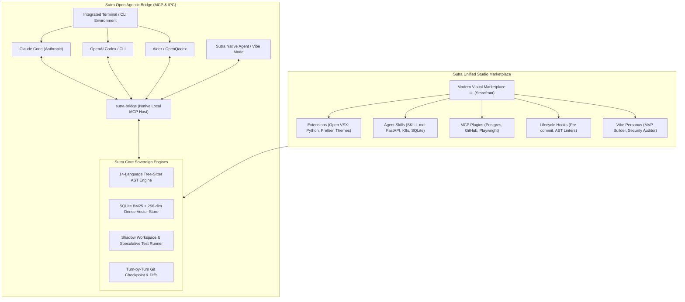
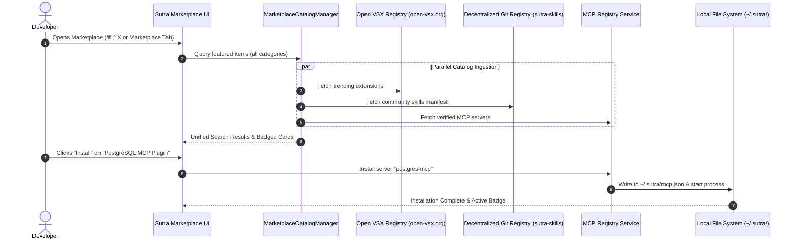
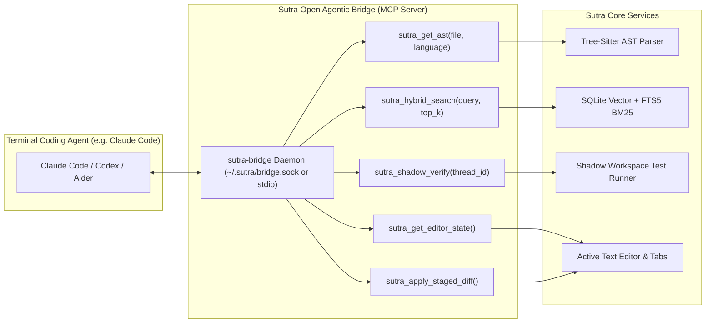
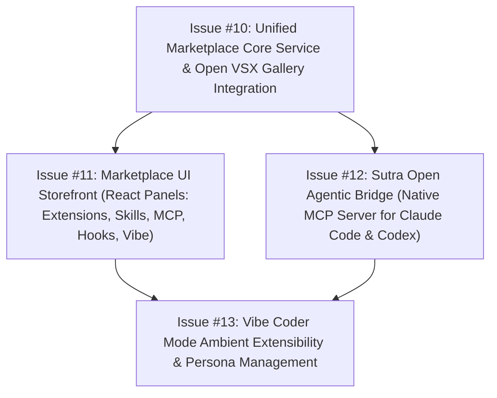

# Sutra IDE: Unified Studio Marketplace & Open Agentic Ecosystem Specification

## Executive Vision

Modern AI code editors suffer from two opposing extremes:
1. **The Fragmented Legacy Editor (VS Code)**: Offers a vast extension gallery for syntax and linters, but treats AI as an afterthought plugin. Agent skills, MCP servers, prompt personas, and terminal agents have no unified catalog or visual management.
2. **The Walled-Garden SaaS (Cursor, Windsurf)**: Provides agentic chat and multi-file editing, but locks developers into proprietary cloud servers, subscription gating ($20-$40/month), opaque telemetry, and treats external terminal agents (Claude Code, OpenAI Codex, Aider) as hostile competitors with zero IDE co-operation.

**Sutra IDE breaks this paradigm** by introducing:
1. **The Unified Studio Marketplace**: A modern, cloud-style visual marketplace combining **VS Code Extensions** (via Open VSX), **Agent Skills** (`SKILL.md`), **MCP Server Plugins**, **Lifecycle Hooks**, and **Vibe Personas** in a single cohesive storefront.
2. **The Open Agentic Bridge (`sutra-bridge`)**: Sutra IDE turns itself into an open runtime host. When developers run Claude Code, Codex, or CLI agents in Sutra's terminal, Sutra exposes its 14-language Tree-Sitter AST, local vector index, and shadow workspace sandbox over Model Context Protocol (MCP).
3. **Vibe Coder Mode with Ambient Extensibility**: A distraction-free canvas where active skills, security guardrails, and vibe personas can be switched fluidly.
4. **100% Privacy & Sovereign Freedom**: Zero telemetry lock-in, zero cloud paywalls, with native support for Indian foundation models (Sarvam AI, Krutrim), global frontier APIs, and local offline models (Ollama/Metal).

---

## 1. Competitive Landscape & Sutra Differentiation Matrix

| Capability | VS Code (Microsoft) | Cursor (Anysphere) | Windsurf (Codeium) | Zed | **Sutra IDE (Sovereign)** |
|---|---|---|---|---|---|
| **Extension Ecosystem** | Proprietary MS Marketplace (thousands) | Open VSX proxy (`cursorapi.com`) | Open VSX proxy | Custom WASM (immature) | **Direct Open VSX + Sovereign Mirror (100% compatible)** |
| **Agent Skills & Workflows** | None native; loose snippet plugins | `.cursorrules` (text files only) | Proprietary Cascades | Basic slash commands | **First-class `SKILL.md` package catalog with 1-click install** |
| **MCP Plugins & Tool Registry** | Manual JSON config via extensions | Buried in settings JSON; fragile | None | Basic context server | **Visual MCP Storefront + 1-click install & environment wizard** |
| **External Agent Support (Claude Code / Codex)** | Isolated shell; no editor AST/vector sharing | Zero integration; competitor lock-in | Zero integration; competitor lock-in | None | **Native `sutra-bridge`: shares AST, vector search & shadow test sandbox** |
| **Vibe Coder Mode** | Zen mode (hides chrome only) | None | None | Clean UI | **Full Vibe Coder Mode (⌘⇧V) with ambient persona & skill switching** |
| **Speculative Self-Healing Sandbox** | None | None (edits directly in working tree) | None | None | **Isolated Shadow Worktree + automatic compilation & test verification** |
| **Privacy & Model Sovereignty** | MS telemetry; Copilot telemetry | Heavy cloud logging; US SaaS lock-in | Proprietary Codeium servers | Partial BYOK | **100% Local-First BYOK + Indian LLMs (Sarvam/Krutrim) + Ollama** |

---

## 2. Component Architecture: The Unified Studio Marketplace

The marketplace is rendered inside Sutra IDE as a primary editor webview / workbench panel (`sutra.marketplace.open`), styled with modern cards, badges, verified tags, search bars, and category filters.

### Marketplace Categories
1. **Extensions**:
   - Integrated with Open VSX (`https://open-vsx.org/vscode/gallery`).
   - Supports searching by language (Python, Rust, TypeScript, Go), themes, linters, debuggers, and keymaps.
   - Preserves manual `.vsix` drag-and-drop installation.
2. **Agent Skills**:
   - Sourced from the decentralized Git catalog (`sutra-skills`) with local offline bundled fallbacks.
   - Shows tags (`database`, `fastapi`, `security`, `frontend`), ratings, author, and `SKILL.md` documentation preview.
3. **MCP Plugins**:
   - Curated catalog of production-tested Model Context Protocol servers:
     - `sqlite-mcp`, `postgres-mcp`, `github-mcp`, `playwright-mcp`, `docker-mcp`, `slack-mcp`.
   - Graphical environment variable prompt modal (e.g. prompt for database connection string or API token safely stored in native OS keychain).
4. **Lifecycle Hooks**:
   - Event-driven hooks that trigger at critical developer lifecycle points:
     - `pre-agent-exec`: validates that agent edits pass AST syntax linting.
     - `post-agent-exec`: triggers shadow test runner.
     - `pre-commit`: automated OpenQodex / secret scanning before git commit.
5. **Vibe Personas**:
   - Pre-packaged personality and behavioral modes for the agent:
     - *Rapid Prototyper*: prioritizes speed and working MVPs with sensible defaults.
     - *Systems Architect*: prioritizes strict typing, documentation, clean interfaces, and zero tech debt.
     - *Security Auditor*: scrutinizes input sanitization, OWASP Top 10, and secret hygiene.

---

## 3. The Open Agentic Bridge (`sutra-bridge`)

When developers run autonomous tools like **Claude Code**, **OpenAI Codex**, or **Aider** inside Sutra's integrated terminal, Sutra does not force them into its own UI. Instead, Sutra acts as an intelligent runtime accelerator:

### Capabilities Exposed to Claude Code / Codex via `sutra-bridge`:
1. `sutra_get_ast`: Returns symbols, callers, callees, and complexity calculated by Sutra's in-process 14-language Tree-Sitter engine in <5ms.
2. `sutra_hybrid_search`: Returns reciprocal-rank-fused semantic and lexical code chunks from Sutra's local SQLite store without calling remote embeddings.
3. `sutra_shadow_verify`: Claude Code can ask Sutra to test a speculative code diff inside Sutra's shadow workspace; Sutra runs the project's test suite and returns structured compiler/test failure logs back to Claude Code for self-correction.
4. `sutra_apply_staged_diff`: Sends Claude Code's approved diff into Sutra's visual editor, highlighting changes with inline accept/reject decorations.

---

## 4. Vibe Coder Mode Integration

In Vibe Coder Mode (triggered via `⌘⇧V` / `Ctrl+Shift+V`):
- Chrome is minimized to maximize conversation and live rendering.
- An **Ambient Pill & Action Bar** is docked unobtrusively in the status area or header:
  - **Persona Badge**: Click to switch between *Rapid Prototyper*, *Architect*, or *Auditor*.
  - **Active Skills Counter**: Shows currently loaded skills (e.g., `⚡ 4 Skills Active`).
  - **Quick Marketplace Launcher**: `⌘⇧P -> "Sutra: Browse Marketplace"` brings up a distraction-free spotlight modal.
  - **Sandbox Status**: Real-time indicator displaying speculative shadow test results (`✓ Tests Passing in Sandbox`).

---

## 5. Implementation Roadmap (Phases & Issues)

- **Issue #10**: `feat(marketplace): unified catalog manager integrating Open VSX, community skills, and MCP registry`
- **Issue #11**: `feat(ui): modern visual marketplace storefront with multi-category tabs and one-click installation`
- **Issue #12**: `feat(bridge): sutra open agentic bridge MCP server for external CLI agents (Claude Code, Codex, Aider)`
- **Issue #13**: `feat(vibe): ambient persona switcher, skill activator, and sandbox status in Vibe Coder Mode`
